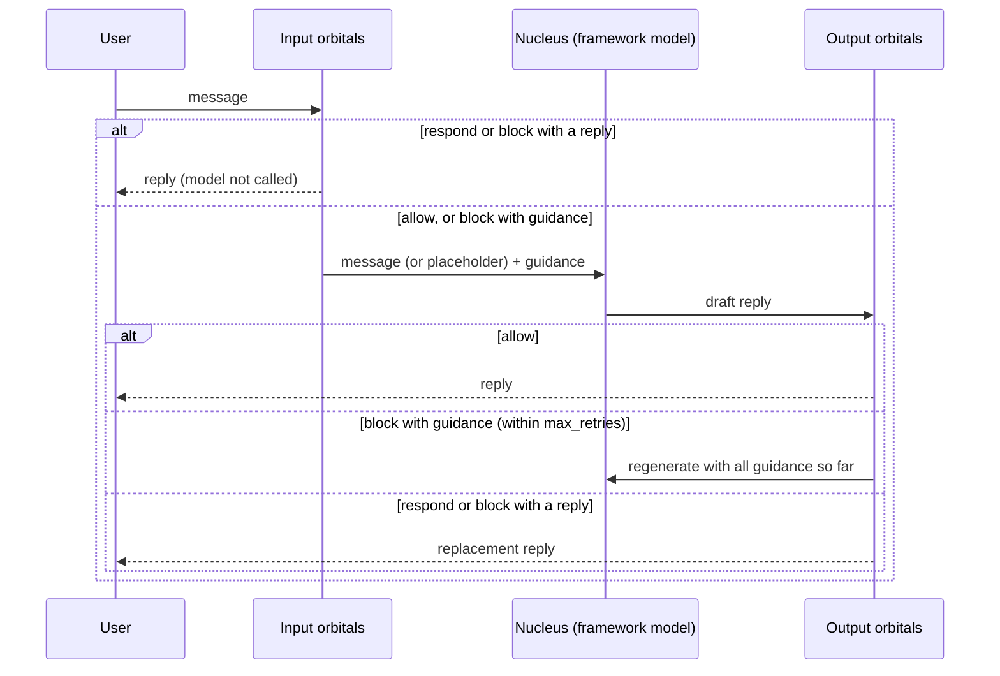

# Concepts

## Overview

{ .cm-page-mascot }
{ .cm-page-mascot }
A chatomon agent is an **atom**: a nucleus that answers the user, surrounded by **orbitals** that check what goes in and what comes out. This page explains the pieces, what an orbital can decide, and what happens to a message during one conversation turn.

## The Atom

| Piece | What it is | Where |
|-------|-----------|-------|
| Instructions | The definition of the nucleus: who it is, what it does, what it must not do. Free text, used only by the nucleus. | `Atom(instructions=...)` |
| Knowledge | Plain text the nucleus draws from, appended to its prompt in a `<knowledge>` section. Retrieval (RAG) is planned for a later version. | `Knowledge` in `src/chatomon/knowledge.py` |
| Connector | The framework and model the atom runs on. | `PydanticAIConnector`, `LangChainConnector`, `MAFConnector`, `MAFFoundryConnector`, `ADKConnector` |
| Input orbitals | Checks run, in order, on the user message before the nucleus sees it. | `Atom(input_orbitals=[...])` |
| Output orbitals | Checks run, in order, on the nucleus reply before the user sees it. | `Atom(output_orbitals=[...])` |

The **nucleus** is the native agent the connector builds: the model with the instructions and the knowledge. `Atom.build()` validates the configuration and returns it; from then on you use the framework's own API.

Orbitals never inherit the atom's instructions or knowledge. Each orbital gets a definition written for its own job, because guard models perform much better with purpose-written descriptions than with the assistant's prompt. Sharing is always explicit — for example, passing the same `Knowledge` object to a judge.

## Verdicts

Every orbital returns a `Verdict` (`src/chatomon/schemas.py`):

| Verdict | On the input side | On the output side |
|---------|-------------------|--------------------|
| `allow` | The message goes on; optional **guidance** is added to this turn's model call | The reply goes on (guidance is ignored) |
| `block` with a reply | The user receives that reply; the model is not called | The reply is replaced |
| `block` with guidance | The model is called **without** the user message, only with the guidance, and writes the refusal | The model rewrites its reply following the guidance |
| `block` with neither | The atom's default refusal is sent | The atom's default refusal is sent |
| `respond` | The orbital answers the user; the model is not called | The reply is replaced by the orbital's text |

A verdict can also carry `annotations` (data for later orbitals, see [Chaining Orbitals](orbitals/index.md#chaining-orbitals)), a short `reason` label for the audit report, and `escalate`, which marks the turn as needing a human.

## A Turn, Step by Step

The engine that implements these rules is `Engine` in `src/chatomon/engine.py`; connectors only translate its decisions into framework hooks.

## Rules That Always Hold

- **Blocked messages never reach the nucleus.** In the stored conversation history a blocked user message is replaced by a placeholder (`[message removed by chatomon]` by default), so it cannot resurface in later turns. (LangGraph checkpointers also keep earlier snapshots of a thread; see [Connectors](connectors/langchain.md#conversations).)
- **Guidance lives for one model call.** It is added to the system prompt of that call only and never stored in the history.
- **Everything the nucleus writes goes through the output orbitals**, including a guided refusal. What an orbital writes does not.
- **Regenerations are capped.** After `max_retries` regenerations (2 by default) the user receives the default refusal. Each regeneration carries every output guidance received so far in the turn, so the model does not reintroduce a problem already fixed.
- **Output orbitals see input annotations** of the same turn; each output attempt starts again from them.
- **Fail-closed.** An orbital that raises or exceeds its `timeout` counts as `block`, unless it is configured with `on_error="allow"`.
- **Only final text replies are checked.** Intermediate model responses that call tools are not.

## Related Documentation

- [Orbitals](orbitals/index.md) — writing and chaining orbitals
- [Connectors](connectors/index.md) — how the rules map onto PydanticAI, LangChain, MAF and Google ADK
- [Observability and Audit](observability.md) — what each turn records

---
**Last Updated:** September 2026
**Status:** Implemented
