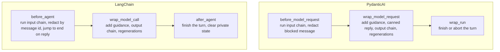

# Connectors

## Overview

A connector builds an atom into a native agent of one framework and installs chatomon's checks as the outermost layer of that agent. Both connectors implement the same rules and pass the same contract test suite (`tests/contract/`); this page explains how each one maps those rules onto its framework and what that means for tools, streaming and conversations.

## What "Native" Means

`Atom.build()` returns the framework's own object, so you keep using the framework's API:

| Connector | Location | `build()` returns | Extra keyword arguments go to |
|-----------|----------|-------------------|-------------------------------|
| `PydanticAIConnector` | `src/chatomon/connectors/pydantic_ai.py` | `pydantic_ai.Agent` with text output | `pydantic_ai.Agent` (`tools`, `deps_type`, `capabilities`, ...) |
| `LangChainConnector` | `src/chatomon/connectors/langchain.py` | LangGraph `CompiledStateGraph` from `create_agent` | `langchain.agents.create_agent` (`tools`, `checkpointer`, `middleware`, ...) |

chatomon sets the prompt and name from the atom, so the arguments that would conflict are refused with `ChatomonConfigError`: `instructions`, `system_prompt`, `output_type` and `name` for PydanticAI; `system_prompt`, `response_format` and `name` for LangChain. Your own capabilities or middleware run inside chatomon's layer.

## How the Rules Map onto Each Framework



In both frameworks the output checks and regenerations happen inside the hook that wraps the model call: the framework only ever sees the approved reply, so rejected drafts never enter the history and guidance is never stored. Both connectors support the async and the sync API of their framework (`run`/`run_sync`, `ainvoke`/`invoke`); sync hooks run the async engine through `chatomon._sync.run_sync`, which also works when an event loop is already running.

## Conversations

| | PydanticAI | LangChain |
|--|-----------|-----------|
| Where the history lives | In the `message_history` you pass to the next run | In the graph's checkpointer |
| Conversation id in reports | The run's `conversation_id`, stable across runs that share the history | The `thread_id` of the run config |
| Blocked messages in the history | Replaced by the placeholder in `all_messages()` | Replaced by the placeholder in the latest checkpoint |

A LangGraph checkpointer keeps every earlier snapshot of the thread, and the snapshot written before chatomon runs still contains the original user message. The nucleus never sees it again — replaying a thread runs the input orbitals again — but it remains in storage: pruning and retention of checkpoints are the application's responsibility, as for any other personal data.

With LangChain, the checkpointer keeps the conversation and its `thread_id` becomes the conversation id of every report:

```python
from langchain_core.language_models.fake_chat_models import GenericFakeChatModel
from langchain_core.messages import AIMessage, HumanMessage
from langgraph.checkpoint.memory import InMemorySaver

from chatomon import Atom, TurnReport
from chatomon.connectors.langchain import LangChainConnector

reports: list[TurnReport] = []
model = GenericFakeChatModel(messages=iter([AIMessage(content="Hi!"), AIMessage(content="Bye!")]))
agent = Atom(
    name="speedypack",
    instructions="Be brief.",
    connector=LangChainConnector(model, checkpointer=InMemorySaver()),
    on_turn=reports.append,
).build()
config = {"configurable": {"thread_id": "customer-42"}}
agent.invoke({"messages": [HumanMessage(content="hello")]}, config)
agent.invoke({"messages": [HumanMessage(content="thanks")]}, config)
assert [report.conversation_id for report in reports] == ["customer-42", "customer-42"]
```

With PydanticAI, pass the previous run's messages to keep the conversation:

```python
from pydantic_ai.models.test import TestModel

from chatomon import Atom
from chatomon.connectors.pydantic_ai import PydanticAIConnector

agent = Atom(
    name="speedypack",
    instructions="Be brief.",
    connector=PydanticAIConnector(TestModel(custom_output_text="Hi!")),
).build()
first = agent.run_sync("hello")
second = agent.run_sync("and now?", message_history=first.all_messages())
assert len(second.all_messages()) == 4
```

## Tools

Tools are declared on the native agent as usual. Model responses that call tools are intermediate steps: output orbitals are not run on them and they do not end the turn. The output chain runs on the final text reply.

## Streaming

| Framework | With input orbitals only | With output orbitals |
|-----------|--------------------------|----------------------|
| LangChain | Tokens stream normally | The model is tagged `nostream` and checked inside the model call, so streaming emits only the approved reply |
| PydanticAI | Tokens stream normally | `run_stream` is refused with `ChatomonConfigError` before the model is called, because PydanticAI streams text before it can be checked; use `run` or `run_sync` |

The LangChain guarantee covers the graph's output streams (`stream` / `astream` with `messages`, `updates` or `values`). **`astream_events` and callback handlers are not a safe user-facing channel when output orbitals exist**: they observe every internal model call, so they also see drafts that the output orbitals later reject. Use them for tracing, not to feed a user interface.

## Judges and Model Resolution

A `JudgeOrbital` without its own connector calls its model through the atom's connector. Each connector has a `resolve_model` setting that maps the judge's model id to a framework model; by default PydanticAI uses the id as a model string and LangChain calls `init_chat_model` with it.

## Tracing

PydanticAI propagates the OpenTelemetry context through its hooks, so chatomon's spans nest under the agent run automatically. LangChain does not; `LangChainConnector` accepts a `parent_span` callable that returns the span chatomon's spans should nest under, and without it they attach to the caller's current span.

## Failures

If the model or the framework raises during a turn, the connector closes the turn with `Engine.abort_turn` — the report says `aborted` and records the exception type — and the exception propagates to your code. In LangChain this covers failures of the model call and of tools. A turn interrupted by `interrupt()` (human in the loop) stays open and is closed when the graph resumes; if it is resumed by another process or agent instance, chatomon rebuilds the turn and runs the input orbitals again before the model is called, so the reply is always checked. A turn left behind by a failure elsewhere is closed as `aborted` when the next message arrives on the same thread.

## Related Documentation

- [Concepts](concepts.md) — the rules connectors implement
- [Observability and Audit](observability.md) — spans and reports produced during a turn
- [API Reference](reference/index.md) — runnable examples for both connectors

---
**Last Updated:** September 2026
**Status:** Implemented
