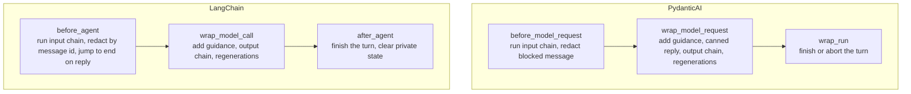

# Connectors

## Overview

A connector builds an atom into a native agent of one framework and installs chatomon's checks as the outermost layer of that agent. Both connectors implement the same rules and pass the same contract test suite (`tests/contract/`); this page covers what they share, and each framework has its own page for conversations, streaming and tracing.

## Table of Contents

| Document | Description |
|----------|-------------|
| [PydanticAI](pydantic_ai.md) | `PydanticAIConnector`: the agent it builds, message history, streaming limits, tracing |
| [LangChain / LangGraph](langchain.md) | `LangChainConnector`: the graph it builds, checkpointers, streaming, `parent_span`, human in the loop |

## What "Native" Means

`Atom.build()` returns the framework's own object, so you keep using the framework's API:

| Connector | `build()` returns | Extra keyword arguments go to |
|-----------|-------------------|-------------------------------|
| [`PydanticAIConnector`](pydantic_ai.md) | `pydantic_ai.Agent` with text output | `pydantic_ai.Agent` |
| [`LangChainConnector`](langchain.md) | LangGraph `CompiledStateGraph` from `create_agent` | `langchain.agents.create_agent` |

chatomon sets the prompt and name from the atom, so the arguments that would conflict are refused with `ChatomonConfigError` (listed on each framework's page). Your own capabilities or middleware run inside chatomon's layer.

## How the Rules Map onto Each Framework

In both frameworks the output checks and regenerations happen inside the hook that wraps the model call: the framework only ever sees the approved reply, so rejected drafts never enter the history and guidance is never stored. Both connectors support the async and the sync API of their framework (`run`/`run_sync`, `ainvoke`/`invoke`); sync hooks run the async engine through `chatomon._sync.run_sync`, which also works when an event loop is already running.

## At a Glance

| | PydanticAI | LangChain |
|--|-----------|-----------|
| Where the history lives | The `message_history` you pass to the next run | The graph's checkpointer |
| Conversation id in reports | The run's `conversation_id` | The `thread_id` of the run config |
| Streaming with output orbitals | `run_stream` is refused | Only the approved reply is streamed |
| Span nesting | Automatic | Through `parent_span` |

## Tools

Tools are declared on the native agent as usual. Model responses that call tools are intermediate steps: output orbitals are not run on them and they do not end the turn. The output chain runs on the final text reply.

## Judges and Model Resolution

A `JudgeOrbital` without its own connector calls its model through the atom's connector. Each connector has a `resolve_model` setting that maps the judge's model id to a framework model; by default PydanticAI uses the id as a model string and LangChain calls `init_chat_model` with it.

## Failures

If the model or the framework raises during a turn, the connector closes the turn with `Engine.abort_turn` — the report says `aborted` and records the exception type — and the exception propagates to your code. LangChain's tools and `interrupt()` are covered on [its page](langchain.md#failures-and-human-in-the-loop).

## Key Components

| Component | Location | Purpose |
|-----------|----------|---------|
| `Connector` | `src/chatomon/connectors/base.py` | The extension point every connector implements |
| `PydanticAIConnector` | `src/chatomon/connectors/pydantic_ai.py` | Builds atoms into PydanticAI agents |
| `LangChainConnector` | `src/chatomon/connectors/langchain.py` | Builds atoms into LangChain agents (LangGraph graphs) |
| Contract suite | `tests/contract/` | The rules every connector must pass |

## Related Documentation

- [Concepts](../concepts.md) — the rules connectors implement
- [Observability and Audit](../observability.md) — spans and reports produced during a turn
- [API Reference](../reference/index.md) — the `connectors` pages

---
**Last Updated:** September 2026
**Status:** Implemented
