# Connectors

## Overview

{ .cm-page-mascot }
{ .cm-page-mascot }
A connector builds an atom into a native agent of one framework and installs chatomon's checks as the outermost layer of that agent. The connectors implement the same engine rules and pass the shared contract test suite (`tests/contract/`); each framework has its own page for conversations, streaming and tracing.

## Table of Contents

| Document | Description |
|----------|-------------|
| [PydanticAI](pydantic_ai.md) | `PydanticAIConnector`: the agent it builds, message history, streaming limits, tracing |
| [LangChain / LangGraph](langchain.md) | `LangChainConnector`: the graph it builds, checkpointers, streaming, `parent_span`, human in the loop |
| [Microsoft Agent Framework](maf.md) | `MAFConnector` and `MAFFoundryConnector`: local sessions, Foundry, streaming limits |

## What "Native" Means

`Atom.build()` returns the framework's own object, so you keep using the framework's API:

| Connector | `build()` returns | Extra keyword arguments go to |
|-----------|-------------------|-------------------------------|
| [`PydanticAIConnector`](pydantic_ai.md) | `pydantic_ai.Agent` with text output | `pydantic_ai.Agent` |
| [`LangChainConnector`](langchain.md) | LangGraph `CompiledStateGraph` from `create_agent` | `langchain.agents.create_agent` |
| [`MAFConnector`](maf.md) | `agent_framework.Agent` | `agent_framework.Agent` |
| [`MAFFoundryConnector`](maf.md) | `agent_framework.foundry.FoundryAgent` | `FoundryAgent` |

chatomon sets the prompt and name from the atom, so the arguments that would conflict are refused with `ChatomonConfigError` (listed on each framework's page). Your own capabilities or middleware run inside chatomon's layer.

## How the Rules Map onto Each Framework

```mermaid
flowchart TB
    subgraph PydanticAI
        P1[before_model_request<br/>run input chain, redact blocked message] --> P2[wrap_model_request<br/>add guidance, canned reply, output chain, regenerations]
        P2 --> P3[wrap_run<br/>finish or abort the turn]
    end
    subgraph LangChain
        L1[before_agent<br/>run input chain, redact by message id, jump to end on reply] --> L2[wrap_model_call<br/>add guidance, output chain, regenerations]
        L2 --> L3[after_agent<br/>finish the turn, clear private state]
    end
    subgraph MAF
        M1[AgentMiddleware<br/>run input chain, redact blocked message] --> M2[ChatMiddleware<br/>guidance, final output checks, regenerations]
        M2 --> M3[local session history and turn report]
    end
```

Output checks and regenerations happen around the model call, before approved replies enter conversation history. Guidance is added to the current model request and is not stored. PydanticAI and LangChain support both their native async and sync APIs; MAF exposes an async native API. Both MAF connectors support checked output on non-streaming runs.

## At a Glance

| | PydanticAI | LangChain | MAF |
|--|-----------|-----------|-----|
| Where the history lives | The `message_history` you pass to the next run | The graph's checkpointer | Local `AgentSession` history provider, with `store=False` |
| Conversation id in reports | The run's `conversation_id` | The `thread_id` of the run config | The local `session_id` |
| Streaming with output orbitals | `run_stream` is refused | Only the approved reply is streamed | `run(..., stream=True)` is refused |
| Span nesting | Automatic | Through `parent_span` | Automatic |

## Tools

Tools are declared on the native agent as usual. Model responses that call tools are intermediate steps: output orbitals are not run on them and they do not end the turn. The output chain runs on the final text reply.

## Judges and Model Resolution

A `JudgeOrbital` without its own connector calls its model through the atom's connector. PydanticAI and LangChain accept `resolve_model`; by default PydanticAI uses the ID as a model string and LangChain calls `init_chat_model` with it. MAF needs a `resolve_client` callback because its core package does not resolve model IDs to chat clients.

## Failures

If the model or the framework raises during a turn, the connector closes the turn with `Engine.abort_turn` — the report says `aborted` and records the exception type — and the exception propagates to your code. LangChain's tools and `interrupt()` are covered on [its page](langchain.md#failures-and-human-in-the-loop).

## Key Components

| Component | Location | Purpose |
|-----------|----------|---------|
| `Connector` | `src/chatomon/connectors/base.py` | The extension point every connector implements |
| `PydanticAIConnector` | `src/chatomon/connectors/pydantic_ai.py` | Builds atoms into PydanticAI agents |
| `LangChainConnector` | `src/chatomon/connectors/langchain.py` | Builds atoms into LangChain agents (LangGraph graphs) |
| `MAFConnector`, `MAFFoundryConnector` | `src/chatomon/connectors/maf/` | Build atoms into MAF core and Foundry agents |
| Contract suite | `tests/contract/` | The rules every connector must pass |

## Related Documentation

- [Concepts](../concepts.md) — the rules connectors implement
- [Observability and Audit](../observability.md) — spans and reports produced during a turn
- [API Reference](../reference/index.md) — the `connectors` pages

---
**Last Updated:** September 2026
**Status:** Implemented
