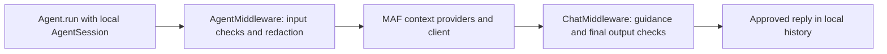

# Microsoft Agent Framework

## Overview

The MAF connectors build native asynchronous agents from an [Atom][chatomon.Atom]. Install `chatomon[maf]` for a client you supply, or `chatomon[maf-foundry]` to use Foundry clients and agents. The core extra does not choose a model provider; install that provider's MAF package separately when needed.

| Connector | Native result | Output orbitals |
|-----------|---------------|-----------------|
| [`MAFConnector`][chatomon.connectors.maf.MAFConnector] | `agent_framework.Agent`, including one backed by `FoundryChatClient` | Supported for non-streaming runs |
| [`MAFFoundryConnector`][chatomon.connectors.maf.MAFFoundryConnector] | `agent_framework.foundry.FoundryAgent` connected to an existing PromptAgent or HostedAgent | Supported for non-streaming runs; live continuity verified with a PromptAgent |

## Building an Agent

`MAFConnector` accepts a MAF chat client and forwards its other arguments to `Agent`. `MAFFoundryConnector` forwards Foundry settings such as `project_endpoint`, `agent_name`, `agent_version`, and credentials to `FoundryAgent`. Use the full project endpoint ending in `/api/projects/<project-name>`; a PromptAgent also needs its version. The atom supplies the local agent's name, instructions, and knowledge; conflicting arguments fail at build time. Both paths require a chat client with `ChatMiddlewareLayer`. `MAFFoundryConnector` selects its client type to preserve the atom's instructions and refuses a caller-supplied `client_type`.

For output checks, place application middleware in the connector's `middleware` argument. Preconfigured chat middleware on a client could rewrite a checked reply after chatomon's hook, so `MAFConnector` refuses that combination.

```{.python test="skip"}
from agent_framework.foundry import FoundryChatClient
from azure.identity.aio import DefaultAzureCredential

from chatomon import Atom
from chatomon.connectors.maf import MAFConnector

client = FoundryChatClient(
    project_endpoint="https://example.services.ai.azure.com/api/projects/my-project",
    model="my-deployment",
    credential=DefaultAzureCredential(),
)
agent = Atom(
    name="support",
    instructions="Answer customer questions briefly.",
    connector=MAFConnector(client),
).build()
session = agent.create_session()
reply = await agent.run("Hello", session=session)
```

For an existing Foundry PromptAgent or HostedAgent, replace the connector with `MAFFoundryConnector`. Foundry controls the remote agent configuration. The connector sends the atom's instructions and knowledge as a developer message on each model call, since Foundry rejects the request-level `instructions` field when an agent is specified. Guidance joins that message for the current call only.

```{.python test="skip"}
from azure.identity.aio import DefaultAzureCredential

from chatomon import Atom
from chatomon.connectors.maf import MAFFoundryConnector

agent = Atom(
    name="support",
    instructions="Answer customer questions briefly.",
    connector=MAFFoundryConnector(
        project_endpoint="https://example.services.ai.azure.com/api/projects/my-project",
        agent_name="support-agent",
        agent_version="1",
        credential=DefaultAzureCredential(),
    ),
).build()
reply = await agent.run("Hello", session=agent.create_session())
```

## Checks and Local History

The outer `AgentMiddleware` reads the local session history, runs input orbitals, and replaces a blocked user message with the atom's placeholder before other agent hooks or model calls. `ChatMiddleware` adds guidance to the current request, checks final text replies, and substitutes or regenerates rejected drafts before MAF writes the reply to local history. Intermediate tool calls are passed through until a final text reply exists. The connector adds `InMemoryHistoryProvider` when no loading history provider is supplied.



Pass the same `AgentSession` from `agent.create_session()` to subsequent turns. Its `session_id` appears as the conversation id in chatomon reports. The connector sets `store=False` and rejects `store=True`, remote conversation IDs, explicit Foundry agent session IDs, and sessions with `service_session_id`. A provider that returns a remote conversation ID despite `store=False` causes the run to abort. A Foundry HostedAgent may still create an internal infrastructure session ID in its local state; chatomon refuses to send that ID on a later turn. Foundry's own retention and logging policies govern service-side records.

The `resolve_client(model_id)` callback is required when a `JudgeOrbital` uses this connector. It returns a MAF chat client for the judge's model ID; the judge call uses a separate agent with `store=False`. If the callback is missing, `Atom.build()` fails with a configuration error.

## Streaming and Failures

MAF's native API is asynchronous. With input orbitals only, `run(..., stream=True)` returns a MAF `ResponseStream`; completed and cancelled streams produce a turn report. If the atom has output orbitals, streaming raises `ChatomonConfigError` before the model call because tokens would otherwise leave before the final reply can be checked. Use the non-streaming `run()` path for checked output.

Model and middleware failures abort the turn and preserve the exception type in the report. Message content, guidance, and judge explanations are absent from chatomon logs and reports by default; the atom's `capture_content` policy controls optional capture.

Output checks on `MAFFoundryConnector` were verified against a Foundry v2 PromptAgent. With `store=False`, a rejected draft was absent from the next request and reply after both replacement and regeneration; only the approved reply entered the local history. This test does not cover HostedAgent runtime sessions, which may require a remote `agent_session_id` that chatomon refuses to reuse.

## Related Documentation

- [Connectors](index.md) — shared connector behavior
- [JudgeOrbital](../orbitals/judge.md) — model-based checks and model resolution
- [Observability and audit](../observability.md) — reports and content capture
- [MAF API reference](../reference/connectors_maf.md) — parameters, return values, and exceptions

---
**Last Updated:** September 2026
**Status:** Implemented
