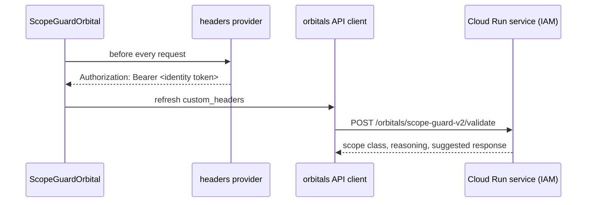

# ScopeGuard on Cloud Run

## Overview

A ScopeGuard V2 server (the `orbitals` library's FastAPI app in front of vLLM) can run on a Cloud Run GPU service that only authorised identities may call. The `orbitals` API client cannot sign requests by itself; chatomon's `headers` provider fills that gap, so an orbital can call the private service directly.

## Calling a Private Service



The `headers` setting of `ScopeGuardOrbital` (and `ClaimExtractorOrbital`) takes a sync or async function returning HTTP headers. It is called before every request — identity tokens expire after an hour — and its headers are merged into the client's `custom_headers`, keeping an `X-API-Key` if one is set. Sync providers run in a worker thread, so a slow token fetch still respects the orbital's `timeout`. The client must use the `api` backend.

Two common providers:

| Identity | Token source |
|----------|--------------|
| A developer | `gcloud auth print-identity-token` (the caller needs the Cloud Run invoker role) |
| A service account in production | `google.oauth2.id_token.fetch_id_token` with the service URL as audience |

A developer setup, with the token taken from `gcloud` before every request:

```{.python test="skip"}
import subprocess

from orbitals.scope_guard_v2 import AsyncScopeGuardV2
from orbitals.types import AIServiceDescriptionV2

from chatomon.orbitals.principled import ScopeGuardOrbital


def identity_token() -> dict[str, str]:
    token = subprocess.run(
        ["gcloud", "auth", "print-identity-token"], check=True, capture_output=True, text=True
    ).stdout.strip()
    return {"Authorization": f"Bearer {token}"}


scope_guard = ScopeGuardOrbital(
    guard=AsyncScopeGuardV2(backend="api", api_url="https://scope-guard-xyz.a.run.app"),
    description=AIServiceDescriptionV2(
        identity_role="Customer assistant of SpeedyPack", context="Parcel shipments"
    ),
    headers=identity_token,
    timeout=60,
)
```

The alternative is `gcloud run services proxy`, which exposes the service on a local port with the caller's credentials; the orbital then points at the local address and needs no headers. It suits development only.

## Cold Starts and Timeouts

A GPU service that scales to zero needs minutes to start: the container starts, then vLLM loads the model. During that time the server may already accept connections and fail requests quickly. Choose the orbital's `timeout` with this in mind (the default is 30 seconds) and decide the `on_error` policy explicitly: with the default `"block"`, messages are refused while the guard is unavailable. Async clients (`AsyncScopeGuardV2`) are recommended; the sync client sets no HTTP timeout of its own.

## Verifying a Deployment

The opt-in tests in `tests/integration/test_scope_guard.py` exercise a real deployment: classification of representative messages, a direct call to the private URL with identity-token headers, the rejection of unauthenticated calls, and an end-to-end guided refusal with the PydanticAI connector. They run only with `CHATOMON_INTEGRATION=1` and read the service addresses from `CHATOMON_SCOPE_GUARD_URL` (reachable without authentication, for example through the proxy) and `CHATOMON_SCOPE_GUARD_RUN_APP_URL` (the private `run.app` address). `tests/integration/test_claim_extractor.py` does the same for ClaimExtractor with `CHATOMON_CLAIM_EXTRACTOR_URL`. `CHATOMON_WARMUP_S` sets how long the tests wait for a cold start.

## Related Documentation

- [Orbitals](../orbitals.md) — ScopeGuard's class-to-verdict mapping
- [Observability and Audit](../observability.md) — how guard failures are recorded
- [Deployment](index.md) — section overview

---
**Last Updated:** September 2026
**Status:** Implemented
