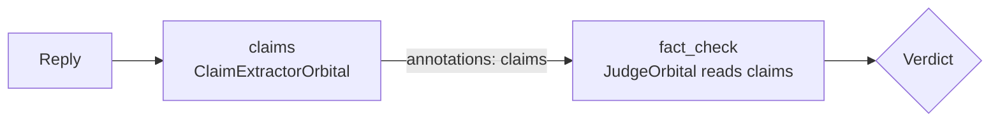

# Orbitals

## Overview

An orbital is a check on a user message before the nucleus sees it, or on a reply before the user sees it. This page covers writing your own orbitals, chaining them through annotations, how errors are handled, and the orbitals chatomon ships with.

## Writing an Orbital

There are two ways, both in `src/chatomon/orbitals/base.py`:

| Way | When to use it |
|-----|----------------|
| The `orbital` decorator on a function | Simple checks. Sync functions run in a worker thread so they never block the event loop; async functions run directly. |
| A subclass of `Orbital` implementing `check()` | Orbitals with configuration or clients, like the built-in ones. |

A check receives an `OrbitalContext` (`src/chatomon/schemas.py`): the text under check, which side it is on, the conversation history (with blocked messages already replaced), the annotations of the orbitals that ran before it, the attempt number on the output side, and the turn and conversation ids. It returns a `Verdict`.

Every orbital has four settings: a `name` (unique within the atom; by default derived from the class or function name), `reads` (see below), a `timeout` in seconds (30 by default) and `on_error` (`"block"` by default). `Orbital.fingerprint()` hashes the configuration returned by `config()`; the hash is recorded in every audit report, so you can tell which version of a check was active.

## Chaining Orbitals

Orbitals run in the order they appear in `input_orbitals` and `output_orbitals`. An orbital can pass data to later ones through the `annotations` of its verdict; they are stored under its name and exposed to later orbitals in `OrbitalContext.annotations`.



An orbital that needs another's annotations declares it with `reads=[...]`. `Atom.build()` then checks that the named orbital is placed earlier in the same chain (or in the input chain, for output orbitals) and refuses the configuration otherwise. If the producer fails during a turn and leaves no annotations, the reader counts as failed too and applies its own `on_error` — a guard never runs silently on missing data. The same orbital instance may appear in both chains.

The example drives the engine directly to show the chain; in an application the connector does this for you.

```python
import asyncio

from chatomon import OrbitalContext, Verdict, orbital
from chatomon.engine import Engine


@orbital(name="topic")
def detect_topic(ctx: OrbitalContext) -> Verdict:
    topic = "tracking" if "parcel" in ctx.message.lower() else "other"
    return Verdict.allow(annotations={"topic": topic})


@orbital(reads=["topic"])
def stay_on_topic(ctx: OrbitalContext) -> Verdict:
    if ctx.annotations["topic"]["topic"] != "tracking":
        return Verdict.block(guidance="Politely say you only help with parcels.")
    return Verdict.allow()


async def main() -> None:
    engine = Engine(atom_name="demo", input_orbitals=[detect_topic, stay_on_topic])
    turn = engine.start_turn()
    decision = await engine.run_input(turn, message="Tell me a joke")
    assert decision.kind == "guided_refusal"


asyncio.run(main())
```

## Errors and Timeouts

| Situation | What happens |
|-----------|--------------|
| `check()` raises, times out, or returns something that is not a `Verdict` | `on_error="block"`: treated as a block with the default refusal. `on_error="allow"`: treated as allow. |
| An orbital in `reads` produced nothing | The reader fails with `MissingAnnotationsError` and applies its `on_error` |
| A sync check never returns | The engine stops waiting at `timeout`, but the worker thread stays busy; give blocking calls their own timeouts |

Every failure is recorded in the turn report with the exception type and the policy applied.

## JudgeOrbital

`JudgeOrbital` (`src/chatomon/orbitals/judge.py`) asks a language model for a structured decision (`JudgeDecision`) and turns it into a verdict. It has its own `instructions`, an optional `context` (reference material, typically a `Knowledge` shared explicitly with the atom) and a `history_window` of recent messages. It calls the model through the atom's connector — so a LangChain atom uses a LangChain model — unless you give it a `connector` of its own; connectors resolve the judge's model id with their `resolve_model` setting.

The model's own label and explanation may quote the user, so they are stored as annotations (treated as content by the privacy settings); the verdict's audit reason is the fixed label `judge_allow`, `judge_block` or `judge_respond`. A malformed decision (for example `respond` without a reply) makes the orbital fail, and `on_error` applies.

## Principled Intelligence Orbitals

`src/chatomon/orbitals/principled.py` wraps the `orbitals` library (extra `principled`). You configure the library's client yourself — local, self-hosted or API backend — and give each orbital its own service description.

`ScopeGuardOrbital` works on the input side with ScopeGuard V1 or V2 and maps the returned class to a verdict:

| ScopeGuard class | Default verdict |
|------------------|-----------------|
| Directly Supported, Potentially Supported | allow |
| Chit Chat | allow, with guidance to reply briefly and steer back to the service |
| Predefined Answer (V2) | respond with ScopeGuard's suggested response |
| Human Oversight (V2) | respond with the suggested response and `escalate` |
| Out of Scope | block with guidance to explain what the service can help with |
| Restricted | block with the default refusal (the nucleus never sees the message) |

Any entry can be overridden with the `mapping` setting, using a fixed verdict or a function of the ScopeGuard result.

A ScopeGuard V2 orbital with its own service description and one override (it needs a running ScopeGuard server):

```{.python test="skip"}
from orbitals.scope_guard_v2 import AsyncScopeGuardV2, ScopeClass
from orbitals.types import AIServiceDescriptionV2

from chatomon import Verdict
from chatomon.orbitals.principled import ScopeGuardOrbital

scope_guard = ScopeGuardOrbital(
    guard=AsyncScopeGuardV2(backend="api", api_url="http://127.0.0.1:8080"),
    description=AIServiceDescriptionV2(
        identity_role="Customer assistant of SpeedyPack, a parcel courier",
        context="Customers ask about their shipments",
        constraints=["Never discuss refunds"],
    ),
    mapping={ScopeClass.CHIT_CHAT: Verdict.allow()},
    timeout=60,
)
```

`ClaimExtractorOrbital` works on both sides and never blocks: it extracts claims and intents from the message and leaves them as annotations for a later orbital, typically a judge that checks the claims against reference material.

Both accept a `headers` provider, called before every request, to refresh credentials such as a Cloud Run identity token — see [ScopeGuard on Cloud Run](deployment/cloud_run.md).

## Related Documentation

- [Concepts](concepts.md) — verdicts and turn rules
- [Observability and Audit](observability.md) — how orbital results are recorded
- [API Reference](reference/index.md) — runnable examples for `orbital`, `Orbital`, `JudgeOrbital` and the engine

---
**Last Updated:** September 2026
**Status:** Implemented
