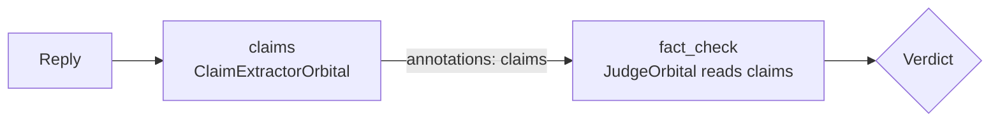

# Orbitals

## Overview

{ .cm-page-mascot }
{ .cm-page-mascot }
An orbital is a check on a user message before the nucleus sees it, or on a reply before the user sees it. Each one returns a `Verdict` that lets the message through, blocks it, or answers in place of the model (see [Verdicts](../concepts.md#verdicts)). This page explains how orbitals are chained and how failures are handled; the pages below cover writing your own and the orbitals chatomon ships with.

## Table of Contents

| Document | Description |
|----------|-------------|
| [Writing your own](custom.md) | The `orbital` decorator, `Orbital` subclasses, what a check receives and the settings every orbital has |
| [JudgeOrbital](judge.md) | A language model that judges messages with its own instructions |
| [Principled Intelligence](principled.md) | The ScopeGuard and ClaimExtractor guard models as orbitals |

## Available Orbitals

| Orbital | Side | Needs | Page |
|---------|------|-------|------|
| Your own (`orbital`, `Orbital`) | input, output | — | [Writing your own](custom.md) |
| `JudgeOrbital` | input, output | a model, called through the atom's connector or its own `connector` | [JudgeOrbital](judge.md) |
| `ScopeGuardOrbital` | input | extra `principled`, a ScopeGuard model (local, self-hosted or API backend) | [Principled Intelligence](principled.md#scopeguard) |
| `ClaimExtractorOrbital` | input, output | extra `principled`, a ClaimExtractor model (local, self-hosted or API backend) | [Principled Intelligence](principled.md#claimextractor) |

## Chaining Orbitals

Orbitals run in the order they appear in `input_orbitals` and `output_orbitals`. An orbital can pass data to later ones through the `annotations` of its verdict; they are stored under its name and exposed to later orbitals in `OrbitalContext.annotations`.

An orbital that needs another's annotations declares it with `reads=[...]`. `Atom.build()` then checks that the named orbital is placed earlier in the same chain (or in the input chain, for output orbitals) and refuses the configuration otherwise. If the producer fails during a turn and leaves no annotations, the reader counts as failed too and applies its own `on_error` — a guard never runs silently on missing data. The same orbital instance may appear in both chains.

A runnable example of two chained orbitals is in [Writing your own](custom.md#example-two-chained-orbitals).

## Errors and Timeouts

| Situation | What happens |
|-----------|--------------|
| `check()` raises, times out, or returns something that is not a `Verdict` | `on_error="block"`: treated as a block with the default refusal. `on_error="allow"`: treated as allow. |
| An orbital in `reads` produced nothing | The reader fails with `MissingAnnotationsError` and applies its `on_error` |
| A sync check never returns | The engine stops waiting at `timeout`, but the worker thread stays busy; give blocking calls their own timeouts |

Every failure is recorded in the turn report with the exception type and the policy applied.

## Key Components

| Component | Location | Purpose |
|-----------|----------|---------|
| `Orbital`, `orbital`, `FunctionOrbital` | `src/chatomon/orbitals/base.py` | The extension point and the function decorator |
| `JudgeOrbital`, `JudgeDecision` | `src/chatomon/orbitals/judge.py` | An LLM judge and its structured decision |
| `ScopeGuardOrbital`, `ClaimExtractorOrbital` | `src/chatomon/orbitals/principled.py` | Principled Intelligence guard models |
| `Engine` | `src/chatomon/engine.py` | Runs the chains, applies `reads`, timeouts and `on_error` |

## Related Documentation

- [Concepts](../concepts.md) — verdicts and turn rules
- [Observability and Audit](../observability.md) — how orbital results are recorded
- [API Reference](../reference/index.md) — the `orbitals` pages and the engine

---
**Last Updated:** September 2026
**Status:** Implemented
