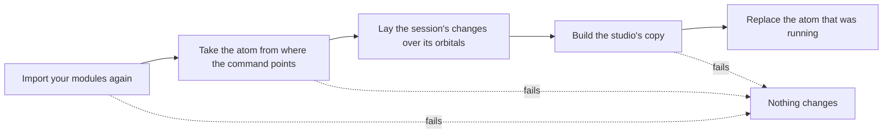

# Reloading the Code

## Overview

While you tune an atom you also change its code: an instruction, a tool, an orbital of your own. **Reload from code**, in the atom's card, loads the atom from your code again without restarting the command. The studio keeps the changes you made to the orbitals and the conversation, and tells you what it could not keep.

## What a Reload Does

Clicking the atom or the nucleus in the drawer opens the atom's card, and **Reload from code** is at its foot. While a turn runs the button is disabled.

A reload replaces everything or nothing. Only when the new atom is built does it take the place of the one that was running; until then, and whenever a step fails, the session is the one you had. The card then shows the atom as your code has it now, under a line that says what the reload did.

When the command points at a function that builds the atom, the function is called again.

## Which Code Is Loaded Again

The studio imports again the modules whose file is under the directory the command was started from, so a change is seen in any of them, also in a module that the atom's module imports.

It leaves alone what is installed, including a virtual environment inside that directory, and chatomon itself. After a change to an installed package, or to code outside the directory, restart the studio.

## What the Studio Keeps

| What you had | After a reload |
|--------------|----------------|
| Settings you changed on an orbital of your code | Applied over the values your code has now. A setting that now equals your code's is no longer a change |
| Orbitals you turned off | Still off |
| Orbitals you added | Still there, with their settings |
| The order of a chain | Yours if you had changed it in the studio, otherwise your code's |
| The conversation and its turns | Kept |
| What **Undo** could bring back | Forgotten: a reload cannot be undone |

This closes the loop with [Copy as code](export.md#copy-as-code). Paste the copied lists into your atom and reload: the session and the code now agree, and the foot of the drawer says the session is the same as your code.

### What Is Dropped

A change that no longer applies is dropped, and the card lists it under **No longer applied**, with the reason:

| What happened in your code | What the studio drops |
|----------------------------|-----------------------|
| An orbital you had changed or turned off is gone | What you had changed on it |
| An orbital you had changed is now of another class | What you had changed on it |
| An orbital now has the name of one you added in the studio | The one you added: your code's takes its place |
| The values your code has now refuse a setting you had changed | What you had changed on that orbital |

An orbital you had not touched and that left your code is not listed: nothing of the studio's was lost.

When the atom cannot be built with the changes that are kept, the reload is refused and says why. This happens, for example, when an orbital you added reads the annotations of one your code no longer has. Change that orbital in the studio, or use **Reset to code**, and reload again.

### The Order of a Chain

A chain you never reordered in the studio takes the order of your code, so an orbital you add in the middle of the list appears in the middle. An orbital you added in the studio stays right after the one it followed.

A chain you did reorder keeps your order, and the orbitals that are new in your code go to its end, as when a preset is applied.

## The Conversation

The conversation goes on after a reload: the next turn sees the turns before it. The turns that ran before the reload stay on the page as they were, with the reports of the code of that moment; saving one of them as a test is covered in [Saving a Turn as a Test](testing.md#turns-from-before-a-reload).

When the reloaded atom is built with a connector of another framework, the conversation cannot be carried over. A new one starts and the card says why; your orbital changes are kept.

## When a Reload Fails

If a module does not import, the function that builds the atom raises, or the atom cannot be built, the card shows the error in one sentence and says that the atom from before is still running. Its orbitals, its changes and its conversation are untouched, and your modules are the ones that were imported before.

The terminal has the traceback, as when the command starts. It is not sent to the page: a traceback shows lines of your source.

Fix the code and reload again.

## Limits

- **Your modules run again.** The code at the top level of a module runs at every reload. What it creates, such as clients, checkpointers and connections, is created again, and what it registers elsewhere is registered twice. The studio does not close what the earlier import created. When a module holds something that cannot exist twice, such as a lock or a file open for writing, restart instead.
- **Only your project is loaded again.** Installed packages and code outside the directory the command was started from need a restart.
- **No reload with `serve()`.** Started from Python, the studio does not know which module the atom comes from, and the card has no button: restart your script.
- **A reload cannot be undone.** The code on disk is the code that runs.
- **Nothing is reloaded by itself.** The studio does not watch your files: it reloads when you ask.

## Key Components

| Component | Location | Purpose |
|-----------|----------|---------|
| `reimporting`, `project_modules` | `src/chatomon/studio/_loading.py` | Import the project's modules again, or leave them as they were |
| `carried` | `src/chatomon/studio/_presets.py` | Lays a session's changes over the reloaded code and says what it drops |
| `Session.reload` | `src/chatomon/studio/_session.py` | Prepares the new atom and replaces the one that was running |

## Related Documentation

- [Studio](index.md) — starting the studio with the command or with `serve()`
- [Tuning Orbitals](tuning.md) — the changes a reload carries over
- [Back to Code](export.md) — Copy as code, and presets, which follow the same rules
- [Saving a Turn as a Test](testing.md) — tests of turns that ran before a reload
- [Frameworks in the Studio](frameworks.md) — how each connector keeps the conversation

---
**Last Updated:** October 2026
**Status:** Implemented
