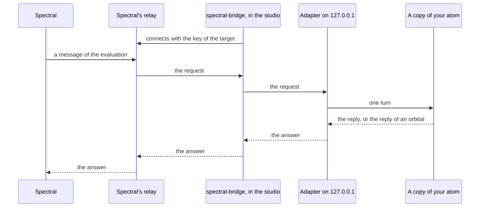

# Evaluating with Spectral

## Overview

{ .cm-page-mascot }
{ .cm-page-mascot }
[Spectral](https://spectral.principled.app) is the evaluation platform of Principled Intelligence: it holds many conversations with a chatbot and judges them. With the `spectral` add-on the studio connects the atom you are tuning to a target on Spectral, so an evaluation runs against that atom, with the orbitals as they are in the session.

The studio does two things: it answers Spectral's requests with turns of the atom, and it counts what every orbital decided on them. Evaluations are launched on Spectral, and their results are read there.

## Key Features

- **One click from the page** — a ghost on the stage and a chip in the header open the Spectral card, where you connect, test and disconnect.
- **Real turns** — each request from Spectral runs the atom as a user's message would: orbitals, nucleus, tools.
- **The session's orbitals** — a request meets the orbitals as you tuned them, and the next request meets a change you make.
- **Counts, not text** — for each orbital, how many times it allowed, blocked, answered or failed. No text of the requests is shown or written.
- **An add-on** — without the `spectral` extra the studio is the same as before: no ghost, no chip, nothing asked from the server.

## Before You Start

You need a target on Spectral of the **Internal** kind, and its key. Spectral shows the key once, when the target is saved.

Install the `spectral` extra together with the extra of the atom's framework. It brings the studio with it:

```bash
pip install 'chatomon[spectral,pydantic-ai]'
```

Put the key in an environment variable in the shell the studio starts from. The studio looks for `SPECTRAL_BRIDGE_API_KEY` unless you name another variable in the card:

```bash
export SPECTRAL_BRIDGE_API_KEY='the key of your target'
chatomon studio speedypack.app:atom
```

A target can use either protocol Spectral offers, **Responses** or **Chat Completions**: the studio answers both. They differ in who keeps the conversation: see [Conversations](#conversations).

## Connecting

Open the Spectral card from the ghost on the stage or from the **Spectral** chip in the header. The card has four rows, in the order a request travels.

| Row | What it shows | What you do |
|-----|---------------|-------------|
| **Key** | The name of the environment variable that holds the key, and whether it is set | Write another name if your key is elsewhere. The name is all the page ever sees: the server reads the value |
| **Relay** | The address of Spectral's relay and what the connection is doing | Nothing: the address comes from where the studio was started |
| **Adapter** | The local address that receives the requests, while connected | Nothing: it opens when you connect and closes when you disconnect |
| **Atom** | How the last test request went | **Send a test request** runs one turn on a sample message, built like a request from Spectral. It is not counted and not added to the conversation |

Before you connect, the card lists what there is to know about your atom, such as a place the turns write to. The notes are about the atom as it is now: after a reload of your code, they are the new atom's.

**Connect** opens the connection. Then, on Spectral, open your target, press **Test connection** and launch an evaluation. **Disconnect** closes the connection and lets the requests that are running finish. Stopping the studio closes it too.

The ghost and the chip say where the connection is.

| Ghost | | Chip | When |
|-------|---|------|------|
| sleep | { width="64" }{ width="64" } | **Spectral** | Not connected |
| connect | { width="64" }{ width="64" } | **connecting**, **disconnecting** | The connection is opening, or closing while the last requests finish |
| orbit | { width="64" }{ width="64" } | **connected** | Spectral can reach the atom: the ghost goes around it |
| evaluate | { width="64" }{ width="64" } | **N requests** | Requests are arriving: the ghost goes faster and leaves a trail |
| lost | { width="64" }{ width="64" } | **reconnecting** | The connection fell and is being tried again |
| refused | { width="64" }{ width="64" } | **key refused**, **upgrade needed**, **stopped** | Spectral refused the connection, which is not tried again |

The ghost goes around the atom only while Spectral can reach it. During a turn you send yourself it waits in its corner: the stage is the atom's.

## What Happens to a Request



The studio connects outwards to Spectral's relay: nothing on your machine listens to the network. The relay hands each request to `spectral-bridge`, which runs inside the studio and passes it to a small local server, the adapter.

Each request is one real turn. The models are called, the tools run, and a turn costs what a turn costs, as many times as the evaluation asks. Up to four turns run at the same time; the others wait.

The turn runs on a copy of your atom, built with the orbitals as they are in the session when the request arrives. Turn an orbital off and the next request runs without it. A request that arrives while the code is being reloaded waits for the reload.

Spectral gets what a user would get: the reply, or the reply of the orbital that blocked the message. It gets text only: the tools the atom called are not reported.

These turns are not in the conversation of the page and have no report to open. The stage says **Answering Spectral** while they arrive.

### Conversations

A target on the **Responses** protocol sends the first message of a conversation, and then each new message with the name of the answer before it. So the studio keeps the conversations Spectral can continue, in the form the atom's framework keeps them. A message an orbital blocked stays out of the conversation, replaced by the atom's placeholder, as where your application keeps the conversation itself.

These conversations are held in memory, only while the connection is open. They are never shown, logged or written, and they are forgotten when you disconnect.

There is room for the conversations of a thousand answers, and for about 32 million characters in all. When the room ends, the studio first forgets the answers that a later one already continued, then the oldest. A conversation that grows beyond about 4 million characters is not kept at all. A request that continues an answer that is no longer kept is answered with an error.

A target on the **Chat Completions** protocol sends the whole conversation with every message, and the studio keeps nothing. There a message an orbital blocked comes back as it was written, in the history of the next turn: it is what happens wherever the client keeps the conversation.

## Reading the Counts

The card counts the requests of the connection. The counts start again when you connect and with **Reset the counts**, and they stay on the card after you disconnect.

{ .cm-shot width="824" loading=lazy }
{ .cm-shot width="824" loading=lazy }

| Count | What it counts |
|-------|----------------|
| **requests** | The requests that reached a turn |
| **running now** | The turns in progress |
| **average turn** | How long a turn took, on average |
| **failed** | The requests answered with an error: the model or a tool raised, or the turn ended with no reply. Shown when there are any |
| The pills | How the turns ended: `answered`, `guided_refusal`, `orbital_response`, `blocked`, `fallback_refusal` |
| **allow**, **block**, **respond** | For each orbital, what it decided |
| **error** | The times the orbital failed |
| **not run** | The requests the orbital was on for and did not see: an earlier orbital ended the turn, or the turn failed before reaching it |
| **average** | How long the orbital's check took |

An output orbital runs once for every attempt of the nucleus, so its numbers can add up to more than the requests.

Two notes can appear under the table. One says that the orbitals changed while the counts were running, so the numbers mix more than one configuration: reset the counts to start clean. The other says that some requests got no turn, because Spectral sent something the studio does not read or continued a conversation that is no longer kept.

## What Leaves Your Machine

| | Where it goes |
|---|---------------|
| The key of the target | To Spectral's relay, when the connection opens. The page never has it: it names a variable, and the server reads the value |
| The replies of the atom | To Spectral, as the answers to its requests |
| Orbital names, settings, reports, counts | Nowhere: they stay in the studio |
| The text of the requests | Nowhere else: it is not shown, logged or written. The conversations Spectral can continue are in memory until you disconnect |

The address of the relay comes from the environment the studio was started in: `SPECTRAL_BRIDGE_RELAY_URL`, or Spectral's own. The page cannot set it, and only a `wss://` address is taken.

The adapter listens on `127.0.0.1`, on a port the system chooses, and only while the connection is open. Its address carries a key of that connection, which is never shown; the studio hides it in what `httpx` logs. It refuses requests that come from a page in a browser. Spectral's requests arrive with headers of their own, an `Authorization` among them: the adapter reads none of them.

A connection can be opened only when the studio listens on this machine. Started on a network address, the card says so and offers no **Connect**.

The libraries under the add-on log through your logging setup, like any other. With `DEBUG` on for `websockets`, that library logs the headers of the connection, the key among them, and the messages. A process that traces `httpx` records the adapter's address with its key. With no logging set up at all, Python prints the warnings of `spectral-bridge` in the terminal, such as a line at every ++ctrl+c++.

## Limits

- **Text only.** Spectral judges what the atom says. Evaluating the tools it calls is not supported.
- **Results stay on Spectral.** The studio shows counts; conversations and verdicts are read on Spectral.
- **Changes mix the counts.** An evaluation that runs while you change orbitals is an evaluation of more than one atom. The card says when it happened.
- **A full quota is a failed request.** When the model refuses a call, the request is answered with an error that names the class of the exception, and counted as failed. Retries are set on the model, in your code.
- **This machine only.** A studio started on a network address does not connect.
- **What a turn can rely on depends on the framework.** The limits of [Frameworks in the Studio](frameworks.md) hold here too: dependencies, runtime contexts and turns that wait for an answer.

## Troubleshooting

| What you see | What to do |
|--------------|------------|
| `the environment variable that api_key_env names is not set`, under the Key row | Set the variable in the shell and start the studio again: the studio reads the environment it was started in |
| **key refused** | The key is not the one of this target. Spectral shows a key once: create a new one for the target |
| **upgrade needed** | Spectral speaks a newer version of its protocol: upgrade `spectral-bridge` |
| `The relay is not answering. Trying again.` | The relay cannot be reached from this machine: check the network. It keeps trying |
| **reconnecting** | The connection fell. It is tried again without your help |
| Requests that failed with a class such as a rate limit error | The model refused the call. The terminal has what the framework printed |
| Requests that got no turn, right after connecting again | Spectral continued conversations of the connection before, which are no longer kept. Launch the evaluation again |

## Key Components

| Component | Location | Purpose |
|-----------|----------|---------|
| `Bridge` | `src/chatomon/studio/_spectral/_bridge.py` | Connects the session's atom to Spectral, runs the requests and keeps the conversations they continue |
| The adapter | `src/chatomon/studio/_spectral/_adapter.py` | The local server that checks a request and answers it |
| The reader | `src/chatomon/studio/_spectral/_shapes.py` | Reads Responses and Chat Completions requests, writes their answers |
| `Counts` | `src/chatomon/studio/_spectral/_counts.py` | Adds up what the orbitals decided |
| `Relay` | `src/chatomon/studio/_spectral/_relay.py` | Keeps the client of `spectral-bridge` running and reads its state |
| The page | `src/chatomon/studio/static/js/spectral/` | The ghost, the chip and the card |

## Related Documentation

- [Studio](index.md) — installing, starting, content and security
- [Reading the Screen](screen.md) — the stage the ghost shares with the atom
- [Frameworks in the Studio](frameworks.md) — what a turn can rely on with each connector
- [Observability and Audit](../observability.md) — final actions and what an orbital's result holds

---
**Last Updated:** October 2026
**Status:** Implemented
